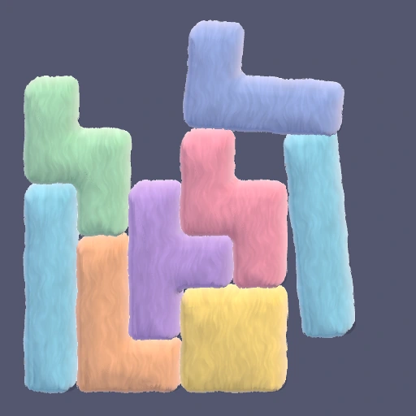

# 毛绒俄罗斯方块（Plush Tetris）

用马卡龙色的毛绒积木堆叠与消行，享受柔软回弹、落地形变与织物光影的 3D 俄罗斯方块。核心规则由 Rust/WASM 驱动，渲染采用 React Three Fiber 与 Three.js。



## 说明

详细设计见 [docs/tetris.md](docs/tetris.md)。支持难度选择、自定义键位、存档恢复与音效控制。

## 本地运行

安装 Bun 1.4.2、Node.js 22.12+ 以及 Rustup（按 `rust-toolchain.toml` 自动配置工具链与 `wasm32-unknown-unknown` 目标）。

```sh
bun install
bun run dev
```

| 命令 | 说明 |
| --- | --- |
| `bun run build:wasm` | 编译 Rust 核心规则为 WebAssembly |
| `bun run dev` | 构建 WASM 并启动 Vite 开发服务器 |
| `bun run test` | 运行前端单元测试与 Rust 引擎测试 |
| `bun run typecheck` | TypeScript 类型检查 |
| `bun run lint` | ESLint 代码检查 |
| `bun run build` | 构建 WASM、类型检查并输出 `dist/` |
| `bun run preview` | 预览生产构建 |
| `bun run test:browser` | 运行 Playwright 浏览器端测试 |
